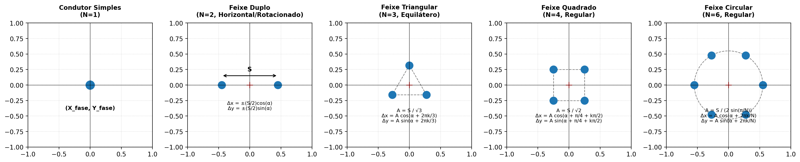
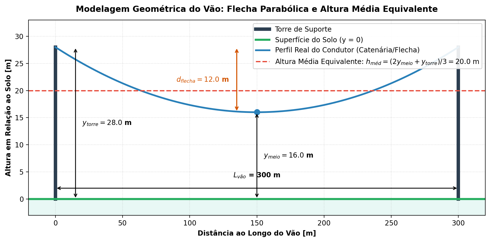
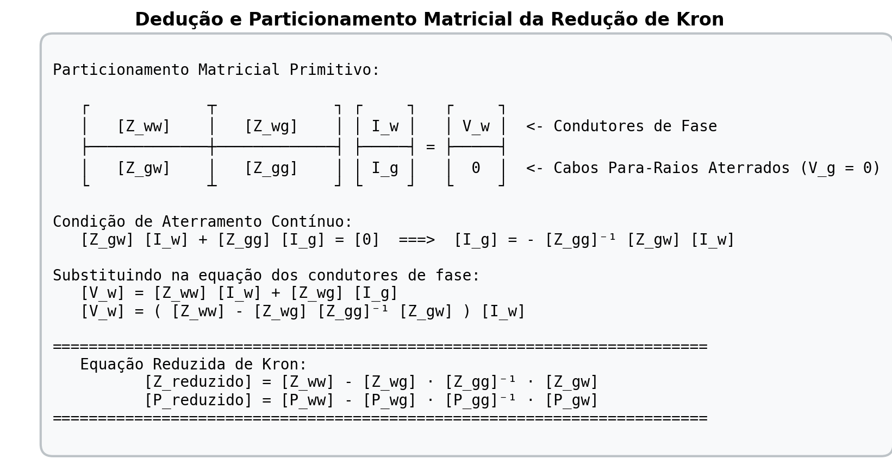
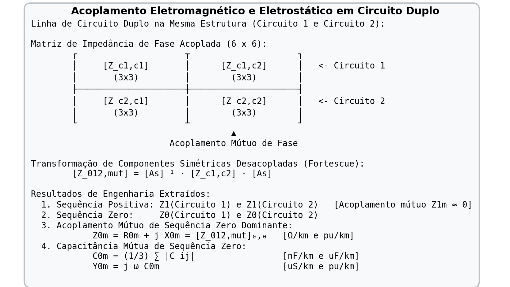

# Calculadora de Parâmetros Elétricos de Linhas de Transmissão (C++17)

Biblioteca e aplicação modular de alta precisão para cálculo de parâmetros elétricos concentrados e distribuídos de linhas aéreas de transmissão de energia elétrica em regime permanente. O núcleo de cálculo fundamenta-se estritamente nas formulações teóricas do EMTP (H. W. Dommel), nas equações de retorno pela terra de Carson com aproximação de profundidade complexa de Dubanton/Deri, na teoria de coeficientes de potencial eletrostático de Maxwell, na norma ABNT NBR 11301 / IEC e na modelagem de sistemas de distribuição e transmissão de William H. Kersting.

O código foi projetado segundo o padrão C++17, sendo totalmente agnóstico de plataforma e desprovido de dependências de bibliotecas externas proprietárias ou pesadas. Todo o motor numérico opera isolado da camada de interface, permitindo integração direta com interfaces gráficas em wxWidgets, Qt ou chamadas de simulação em lote.

---

## 1. Visão Geral e Capacidades

O software executa o levantamento completo dos parâmetros fundamentais de linhas de transmissão aéreas:

* **Topologias Suportadas:** Linhas em circuito simples (trifásicas), circuito duplo na mesma estrutura (6 fases) e linhas polifásicas gerais com acoplamento mútuo.
* **Geometria de Feixes:** 1 condutor por fase (simples), 2 condutores (horizontal ou inclinado), 3 condutores (triângulo equilátero), 4 condutores (quadrado regular) e N condutores distribuídos em arranjo circular regular.
* **Cabos Heterogêneos:** Permite especificar condutores com diâmetros, formações, resistências e números de subcondutores totalmente diferentes para cada circuito na mesma torre.
* **Cabos Para-Raios:** Suporte a 0, 1 ou 2 cabos para-raios aterrados continuamente em todas as estruturas (eliminados rigorosamente por Redução de Kron) ou seccionados/isolados.
* **Tratamento Condicional da Flecha:** Aceita a cota de meio de vão ou flecha fornecida diretamente pelo projeto da linha; caso indisponível, calcula mecanicamente a catenária parabólica a partir da tração horizontal, peso próprio, pressão do vento e carregamento de gelo.
* **Retorno pela Terra:** Formulação de Carson através do método de imagens de profundidade complexa de Dubanton / Deri / Gary, válido com precisão em frequência industrial e em faixas de transitórios eletromagnéticos.
* **Componentes Simétricas:** Decomposição de Fortescue para linhas transpostas e não transpostas, fornecendo impedância de sequência positiva ($Z_1$), sequência zero ($Z_0$), admitância shunt ($Y_1, Y_0$) e capacitância ($C_1, C_0$).
* **Acoplamento Mútuo entre Circuitos:** Cálculo das impedâncias mútuas de fase e extração analítica do acoplamento mútuo de sequência zero ($Z_{0m}, C_{0m}, Y_{0m}$).
* **Unidades e Bases:** Resultados expressos em $\Omega/\text{km}$, $\text{pu/km}$, $\text{nF/km}$, $\mu\text{S/km}$, bem como os totais integrados para o comprimento $L$ da linha em $\Omega$, $\text{pu}$ e $\mu\text{F}$, dados $V_{\text{base}}$ e $S_{\text{base}}$.

---

## 2. Fundamentação Teórica e Modelagem Matemática

### 2.1 Topologia, Geometria e Efeito da Flecha

#### Geometria dos Subcondutores do Feixe (Bundles)
O usuário fornece a coordenada do centro geométrico da fase $(X_{\text{fase}}, Y_{\text{fase}})$ na estrutura predominante, o número de subcondutores ($N$), o espaçamento de catálogo entre subcondutores adjacentes ($S$) e o ângulo de inclinação ($\alpha$). As coordenadas de cada subcondutor individual $k$ ($k = 0, \dots, N-1$) são calculadas pelo programa:

1. **Condutor Simples ($N=1$):** $(x, y) = (X_{\text{fase}}, Y_{\text{fase}})$.
2. **Feixe Duplo ($N=2$):** Subcondutores afastados por $\pm S/2$ ao longo do eixo rotacionado por $\alpha$:
   $$x_k = X_{\text{fase}} \pm \frac{S}{2} \cos\alpha, \quad y_k = Y_{\text{fase}} \pm \frac{S}{2} \sin\alpha$$
3. **Feixe Triangular Equilátero ($N=3$):** Vértices sobre o círculo circunscrito de raio $A = \frac{S}{\sqrt{3}}$:
   $$x_k = X_{\text{fase}} + A \cos\left(\alpha + \frac{2\pi k}{3}\right), \quad y_k = Y_{\text{fase}} + A \sin\left(\alpha + \frac{2\pi k}{3}\right)$$
4. **Feixe Quadrado ($N=4$):** Vértices sobre o círculo circunscrito de raio $A = \frac{S}{\sqrt{2}}$:
   $$x_k = X_{\text{fase}} + A \cos\left(\alpha + \frac{\pi}{4} + \frac{k\pi}{2}\right), \quad y_k = Y_{\text{fase}} + A \sin\left(\alpha + \frac{\pi}{4} + \frac{k\pi}{2}\right)$$
5. **Feixe Circular Regular ($N \ge 4$):** Subcondutores uniformemente distribuídos com raio $A = \frac{S}{2 \sin(\pi / N)}$:
   $$x_k = X_{\text{fase}} + A \cos\left(\alpha + \frac{2\pi k}{N}\right), \quad y_k = Y_{\text{fase}} + A \sin\left(\alpha + \frac{2\pi k}{N}\right)$$



#### Efeito da Flecha e Altura Média Equivalente
Devido ao peso próprio e aos esforços ambientais, o condutor descreve uma curva catenária ao longo do vão. Nos cálculos analíticos bidimensionais de impedância série e capacitância shunt, assume-se que os condutores são paralelos ao plano de terra infinito com uma **altura média equivalente** ($h_{\text{média}}$).

A formulação padrão estabelecida pelo EMTP (Dommel) e pela literatura especializada para perfil parabólico adota:
$$h_{\text{média}} = y_{\text{meio}} + \frac{y_{\text{torre}} - y_{\text{meio}}}{3} = \frac{2 \cdot y_{\text{meio}} + y_{\text{torre}}}{3} = y_{\text{torre}} - \frac{2}{3} d_{\text{flecha}}$$

Caso o projeto da linha não informe diretamente a cota de meio de vão ou a flecha, o programa aciona o cálculo mecânico clássico:
* Força horizontal do vento por metro linear: $w_w = P_{\text{vento}} \cdot (D_{\text{ext}} + 2 t_{\text{gelo}})$
* Força vertical resultante de gelo por metro linear: $w_i = \pi \cdot t_{\text{gelo}} \cdot (D_{\text{ext}} + t_{\text{gelo}}) \cdot \rho_{\text{gelo}}$
* Carga vertical total: $w_{\text{vert}} = w_c + w_i$
* Carga mecânica resultante: $w_r = \sqrt{(w_c + w_i)^2 + w_w^2}$
* Flecha vertical projetada:
  $$d_{\text{flecha}} = \frac{(w_c + w_i) \cdot L_{\text{vão}}^2}{8 \cdot T_{\text{tração}}} \implies y_{\text{meio}} = y_{\text{torre}} - d_{\text{flecha}}$$



---

### 2.2 Caracterização dos Condutores e Efeitos Térmicos/Frequência

Partindo dos dados de catálogo fornecidos pelo usuário em corrente contínua a $20^\circ\text{C}$ ($R_{cc20}$):

1. **Correção de Temperatura:**
   A resistência em corrente contínua na temperatura de operação de projeto $T_{\text{op}}$ é corrigida via:
   $$R_{cc}(T_{\text{op}}) = R_{cc20} \cdot [1 + \alpha_{20} \cdot (T_{\text{op}} - 20)]$$
   onde $\alpha_{20} = 0{,}00403\ ^\circ\text{C}^{-1}$ para alumínio e $\alpha_{20} = 0{,}00393\ ^\circ\text{C}^{-1}$ para cobre (conforme NBR 11301 e Moore).

2. **Efeito Pelicular (Skin Effect):**
   Para frequências industriais e transitórios iniciais, a resistência efetiva em corrente alternada ($R_{ca}$) é calculada através das recomendações da IEC/NBR 11301:
   $$R_{ca} = R_{cc}(T_{\text{op}}) \cdot (1 + y_s)$$
   $$x_s^2 = \frac{8 \pi f k_s \cdot 10^{-7}}{R_{cc}(T_{\text{op}})/1000}$$
   $$y_s = \frac{x_s^4}{192 + 0{,}8 x_s^4} \quad (\text{para } x_s \le 2{,}8)$$
   onde $k_s$ considera a relação de espessura de tubo equivalente ($T/D$).

3. **Reatância Indutiva Interna ($X_{\text{int}}$):**
   Calculada a partir do Raio Médio Geométrico individual de catálogo ($\text{GMR}$ ou $D_s$):
   $$X_{\text{int}} = \omega \cdot \frac{\mu_0}{2\pi} \ln\left(\frac{r}{\text{GMR}}\right) \quad [\Omega/\text{m}]$$

---

### 2.3 Formulações de Retorno pela Terra (Carson vs. Dubanton-Deri)

A presença da terra com condutividade finita ($\sigma = 1/\rho$) altera o caminho de retorno das correntes e introduz perdas dissipativas e variações na indutância de laço.

A formulação exata de Carson define a impedância mútua entre dois condutores paralelos acima da terra como:
$$Z_{ik} = j \omega \frac{\mu_0}{2\pi} \ln\left(\frac{D_{ik}}{d_{ik}}\right) + \Delta Z_{ik,\text{Carson}}$$

Neste software, adota-se a formulação analítica fechada de **Profundidade Complexa de Retorno de Dubanton, Deri e Gary**, recomendada por Dommel para o EMTP:
A terra condutora homogênea é substituída por um plano de retorno equivalente posicionado a uma profundidade complexa $p$ abaixo da superfície física do solo:
$$p = \sqrt{\frac{\rho_{\text{terra}}}{j \omega \mu_0}} \quad [\text{m}]$$

As correções de retorno pela terra tornam-se:
* **Termo próprio de retorno da terra:**
  $$\Delta Z_{ii} = j \omega \frac{\mu_0}{2\pi} \ln\left(\frac{h_i + p}{h_i}\right) \quad [\Omega/\text{m}]$$
* **Termo mútuo de retorno da terra:**
  $$\Delta Z_{ik} = j \omega \frac{\mu_0}{2\pi} \ln\left(\frac{\sqrt{(h_i + h_k + 2p)^2 + \Delta x_{ik}^2}}{D_{ik}}\right) \quad [\Omega/\text{m}]$$
onde $d_{ik} = \sqrt{(x_i - x_k)^2 + (h_i - h_k)^2}$ e $D_{ik} = \sqrt{(x_i - x_k)^2 + (h_i + h_k)^2}$.

Essa formulação evita a divergência ou perda de precisão de séries truncadas quando a frequência aumenta ou quando a separação física entre condutores é grande.

---

### 2.4 Matrizes de Potencial Eletrostático de Maxwell e Capacitâncias

O meio dielétrico do ar é considerado linear e sem perdas ($\varepsilon_r = 1{,}0$), e o solo é admitido como condutor perfeito para os campos eletrostáticos ($V = 0$ em $y = 0$).

Monta-se a matriz primitiva de coeficientes de potencial de Maxwell $[P]$ ($M \times M$, onde $M$ é o número total de condutores físicos):
$$P_{ii} = \frac{1}{2\pi \varepsilon_0} \ln\left(\frac{2 h_i}{r_i}\right) \quad [\text{m/F}]$$
$$P_{ik} = \frac{1}{2\pi \varepsilon_0} \ln\left(\frac{D_{ik}}{d_{ik}}\right) \quad [\text{m/F}]$$

A matriz de capacitâncias nodais é obtida pela inversão da matriz de coeficientes de potencial após as devidas reduções:
$$[C] = [P]^{-1} \quad [\text{F/m}]$$
A matriz de admitância shunt transversal da linha (desprezando perdas por condutância do ar em tempo seco, $G \approx 0$) é:
$$[Y] = j \omega [C] \quad [\text{S/m}]$$

---

### 2.5 Redução de Kron Analítica

Em linhas com cabos para-raios aterrados continuamente em todas as torres, a condição de contorno ao longo de todo o vão impõe potencial elétrico nulo nesses condutores ($V_g = 0$ e $dV_g/dx = 0$).

Particionando as matrizes primitivas em condutores de fase ($w$) e cabos para-raios ($g$):

$$\begin{bmatrix} [V_w] \\ [0] \end{bmatrix} = \begin{bmatrix} [Z_{ww}] & [Z_{wg}] \\ [Z_{gw}] & [Z_{gg}] \end{bmatrix} \begin{bmatrix} [I_w] \\ [I_g] \end{bmatrix}$$

Isolando as correntes induzidas nos para-raios:
$$[I_g] = - [Z_{gg}]^{-1} [Z_{gw}] [I_w]$$
Substituindo na primeira equação, obtém-se a matriz reduzida de Kron:
$$[Z_{\text{reduzido}}] = [Z_{ww}] - [Z_{wg}] [Z_{gg}]^{-1} [Z_{gw}]$$
Identicamente, para a matriz de potenciais eletrostáticos de Maxwell:
$$[P_{\text{reduzido}}] = [P_{ww}] - [P_{wg}] [P_{gg}]^{-1} [P_{gw}]$$



#### Consequência Física nos Parâmetros de Sequência
* **Sequência Positiva ($Z_1$):** As correntes equilibradas induzem pequenas tensões assimétricas nos para-raios, gerando circulação de corrente longitudinal que retorna pela terra e aumenta a resistência efetiva $R_1$ em cerca de 5% a 7%, com impacto mínimo na indutância $X_1$.
* **Sequência Zero ($Z_0$):** As correntes homopolares retornam em fase pela terra e pelos para-raios. A condutividade dos cabos de topo proporciona um caminho metálico que reduz fortemente a reatância de sequência zero ($X_0$) e aprofunda o retorno da corrente.

---

### 2.6 Redução Matricial de Feixes de Subcondutores

Para feixes de múltiplos condutores em paralelo conectados por espaçadores condutores, impõe-se a restrição de igualdade de potencial longitudinal ($V_1 = V_2 = \dots$) e conservação da corrente total da fase ($I_{\text{fase}} = \sum I_k$).

A redução é executada calculando as impedâncias próprias e mútuas equivalentes de fase:
$$Z_{\text{fase}}(p, q) = \frac{1}{N_p N_q} \sum_{i \in p} \sum_{j \in q} Z_{\text{sub}}(i, j)$$
$$P_{\text{fase}}(p, q) = \frac{1}{N_p N_q} \sum_{i \in p} \sum_{j \in q} P_{\text{sub}}(i, j)$$
onde $N_p$ e $N_q$ são as quantidades de subcondutores das fases $p$ e $q$.

---

### 2.7 Componentes Simétricas e Regime de Transposição

A transformação das coordenadas de fase ($a, b, c$) para componentes simétricas ($0, 1, 2$) é realizada através da matriz de Fortescue $[A_s]$:

$$[A_s] = \begin{bmatrix} 1 & 1 & 1 \\ 1 & a^2 & a \\ 1 & a & a^2 \end{bmatrix} \quad \text{com } a = e^{j 120^\circ} = -\frac{1}{2} + j \frac{\sqrt{3}}{2}$$

$$[Z_{012}] = [A_s]^{-1} [Z_{\text{fase}}] [A_s]$$
$$[Y_{012}] = [A_s]^{-1} [Y_{\text{fase}}] [A_s]$$

* **Linha Não Transposta:** A matriz $[Z_{012}]$ contém termos fora da diagonal ($Z_{01}, Z_{02}, Z_{12}$) que expressam o desbalanceamento eletromagnético estrutural real.
* **Linha Idealmente Transposta:** Efetua-se a média aritmética dos elementos diagonais próprios ($Z_s$) e mútuos ($Z_m$):
  $$Z_s = \frac{1}{3} (Z_{aa} + Z_{bb} + Z_{cc}), \quad Z_m = \frac{1}{3} (Z_{ab} + Z_{bc} + Z_{ca})$$
  $$Z_1 = Z_2 = Z_s - Z_m$$
  $$Z_0 = Z_s + 2 Z_m$$
  $$C_1 = C_s - C_m, \quad C_0 = C_s + 2 C_m$$

---

### 2.8 Linhas de Circuito Duplo na Mesma Estrutura

Para estruturas que suportam dois circuitos trifásicos (Circuito 1: fases 0, 1, 2; Circuito 2: fases 3, 4, 5), a matriz de fase reduzida $[Z_{\text{fase}}]$ ($6 \times 6$) é particionada em submatrizes $3 \times 3$:

$$[Z_{\text{fase}}] = \begin{bmatrix} [Z_{c1,c1}] & [Z_{c1,c2}] \\ [Z_{c2,c1}] & [Z_{c2,c2}] \end{bmatrix}$$

Aplicando a transformação de Fortescue desacoplada para os dois circuitos:
$$[Z_{012,\text{mútua}}] = [A_s]^{-1} [Z_{c1,c2}] [A_s]$$

O acoplamento mútuo dominante entre os dois circuitos independentes ocorre no modo homopolar (retorno pela terra compartilhado):

$$
Z_{0m} = R_{0m} + j X_{0m} = [Z_{012,\text{mútua}}]_{0,0} \quad [\Omega/\text{km}]
$$

A admitância e capacitância mútua de sequência zero correspondentes são:

$$
C_{0m} = \frac{1}{3} \sum_{i=0}^2 \sum_{j=3}^5 |C_{ij}| \quad [\text{F/km}], \quad Y_{0m} = j \omega C_{0m} \quad [\text{S/km}]
$$



---

## 3. Especificação de Dados de Entrada e Saída

### Tabela de Parâmetros Primários (Banco de Dados de Cabos)
Estes são os valores obrigatórios que devem constar no cadastro do condutor:

| Parâmetro | Descrição Técnica | Unidade |
| :--- | :--- | :--- |
| `codeName` | Nome comercial / de catálogo do condutor (ex: Drake, Rail, Grosbeak) | Texto |
| `r_dc_20` | Resistência elétrica em corrente contínua a $20^\circ\text{C}$ | $\Omega/\text{km}$ |
| `outsideDiameter` | Diâmetro externo total do cabo | $\text{mm}$ |
| `gmr` | Raio Médio Geométrico individual de catálogo ($D_s$) | $\text{mm}$ |
| `weightPerMeter` | Massa/peso linear do cabo | $\text{kg/m}$ |
| `alpha20` | Coeficiente térmico de variação da resistividade (default $0{,}00403$) | $1/^\circ\text{C}$ |
| `skinRatio` | Relação de espessura de tubo equivalente ($T/D$, default $0{,}5$ maciço) | Adimensional |

### Grandezas Derivadas Calculadas Automaticamente
1. Altura média equivalente do vão ($h_{\text{média}}$).
2. Flecha mecânica do vão ($d_{\text{flecha}}$), caso não fornecida.
3. Coordenadas individuais $(x_k, y_k)$ de cada subcondutor do feixe.
4. Resistência em corrente alternada na temperatura de operação ($R_{ca}(T)$).
5. Reatância indutiva interna individual ($X_{\text{int}}$).
6. Matrizes de distâncias físicas diretas ($d_{ik}$) e às imagens refletidas ($D_{ik}$).
7. Matrizes primitivas e reduzidas $[Z]$, $[P]$, $[C]$ e $[Y]$.
8. Parâmetros em pu baseados em $V_{\text{base}}$ e $S_{\text{base}}$.

---

## 4. Arquitetura Modular do Código C++17

O projeto é estruturado em módulos independentes dentro do diretório `src/`:

```
line_parameters_project/
├── CMakeLists.txt              # Configuração CMake para compilação multiplataforma
├── Makefile                    # Makefile para GCC / Clang
├── README.md                   # Documentação técnica completa
├── images/                     # Diagramas técnicos em alta resolução
│   ├── bundle_geometries.png
│   ├── tower_geometry_and_sag.png
│   ├── kron_reduction_matrix.png
│   └── double_circuit_coupling.png
└── src/                        # Código-fonte C++17
    ├── Types.hpp               # Matrizes, números complexos e inversão Gauss-Jordan
    ├── InputData.hpp           # Estruturas de dados de entrada e catálogo
    ├── ConductorModel.hpp/.cpp # Modelos térmicos e efeito pelicular
    ├── LineGeometry.hpp/.cpp   # Expansão de subcondutores, flecha e distâncias
    ├── LineParameters.hpp/.cpp # Carson/Dubanton, Maxwell, Kron e Feixes
    ├── SymmetricalComponents.hpp/.cpp # Fortescue, transposições e mútua Z0m
    ├── ReportGenerator.hpp/.cpp# Formatador do relatório de engenharia
    └── main.cpp                # Ponto de entrada de teste (LT 230 kV 2x Drake)
```

### Detalhamento dos Módulos

* **`Types.hpp`:** Define os tipos `Complex`, matrizes dinâmicas de precisão dupla `ComplexMatrix` e `RealMatrix`. Implementa algoritmos de inversão de matrizes complexas e reais via eliminação de Gauss-Jordan com pivoteamento parcial de linhas. Padroniza a constante matemática `PI` e as constantes físicas universais `MU_0` e `EPS_0`.
* **`InputData.hpp`:** Define as estruturas `ConductorCatalog`, `BundleConfig`, `PhaseData`, `GroundWireData`, `EnvironmentalData` e `LineSystemInput`.
* **`ConductorModel.hpp / ConductorModel.cpp`:** Executa a correção térmica $R_{cc}(T)$ e calcula o fator de efeito pelicular da IEC/NBR 11301 e a reatância interna $X_{\text{int}}$.
* **`LineGeometry.hpp / LineGeometry.cpp`:** Realiza o cálculo condicional da catenária sob vento/gelo, avalia $h_{\text{média}}$ e expande os feixes de subcondutores no espaço cartesiano bidimensional.
* **`LineParameters.hpp / LineParameters.cpp`:** Monta as matrizes primitivas com os termos de profundidade complexa de Carson/Dubanton, executa a partição matricial e a Redução de Kron analítica nos para-raios aterrados, reduz os feixes e inverte a matriz $[P]$ para extrair $[C]$ e $[Y]$.
* **`SymmetricalComponents.hpp / SymmetricalComponents.cpp`:** Realiza a transformação de Fortescue, trata o regime de transposição e processa linhas de circuito simples ou duplo, isolando o acoplamento mútuo homopolar $Z_{0m}$.
* **`ReportGenerator.hpp / ReportGenerator.cpp`:** Gera o relatório de engenharia formatado com saídas unitárias por quilômetro e totais da linha em grandezas físicas e em pu.

---

## 5. Como Compilar e Executar

### Pré-requisitos
* Compilador C++ com suporte integral a C++17 (GCC 7+, Clang 5+, ou MSVC 2017+).

### Compilação via Makefile (Linux / macOS / MSYS2)
```bash
make
./line_calc
```

### Compilação Direta via GCC / Clang
```bash
g++ -std=c++17 -O2 -Wall -Isrc src/main.cpp src/ConductorModel.cpp src/LineGeometry.cpp src/LineParameters.cpp src/SymmetricalComponents.cpp src/ReportGenerator.cpp -o line_calc
./line_calc
```

### Compilação via CMake (Multiplataforma / Windows / Visual Studio)
```bash
mkdir build
cd build
cmake ..
cmake --build . --config Release
./line_calc
```

---

## 6. Integração com Interface Gráfica (wxWidgets)

O motor numérico é completamente desacoplado de entradas de console ou dependências de sistema operacional. Para acoplar a uma interface em wxWidgets:

1. **Captura dos Dados na Janela:** Os controles de texto e grids da interface gráfica alimentam diretamente a estrutura `LineParameters::LineSystemInput`.
2. **Disparo do Cálculo:** No evento de clique do botão (`wxEVT_BUTTON`):
   ```cpp
   // Instancia e preenche a estrutura com os dados da GUI
   LineParameters::LineSystemInput line;
   // ... leitura dos campos wxTextCtrl ...

   // Chamada do núcleo de cálculo
   auto matrices = LineParameters::LineParametersEngine::compute(line);
   auto seq = LineParameters::SymmetricalComponentsEngine::analyze(
       matrices.Z_phase, matrices.C_phase, matrices.Y_phase, line
   );

   // Geração do relatório em texto ou preenchimento de wxGrid
   std::string relatorio = LineParameters::ReportGenerator::generateReport(line, matrices, seq);
   txtResultado->SetValue(wxString::FromUTF8(relatorio.c_str()));
   ```

---

## 7. Referências Bibliográficas

1. **DOMMEL, H. W.** *calculation-by-hand-transmission-line-parameters-dommel.pdf*. Handout on Transmission Line Parameter Calculations, Department of Electrical Engineering, University of British Columbia, 1985.
2. **EMTP Working Group.** *EMTP4.PDF* e *section09 - Line Constants.pdf*. Electromagnetic Transients Program (EMTP) Rule Book: Overhead Line Constants Module.
3. **KERSTING, W. H.** *Distribution System Modeling and Analysis*. 4. ed. CRC Press, 2017. (Capítulo 4: Series Impedance of Overhead Lines; Capítulo 5: Shunt Admittance of Overhead Lines).
4. **ABNT.** *NBR 11301:1990 - Cálculo da capacidade de condução de corrente de cabos isolados em regime permanente (fator de carga 100%)*. Rio de Janeiro: ABNT, 1990.
5. **MOORE, G. F.** *Electric Cables Handbook*. 3. ed. BICC Cables, Blackwell Science, 1997.
6. **SIVANAGARAJU, S.; SATYANARAYANA, S.** *Electric Power Transmission and Distribution*. Pearson Education, 2008. (Capítulo 2: Line Parameters; Capítulo 7: Mechanical Design of Overhead Lines).
7. **WU, A.; NI, B.** *Line Loss Analysis and Calculation of Electric Power Systems*. IEEE Press, John Wiley & Sons, 2015.
